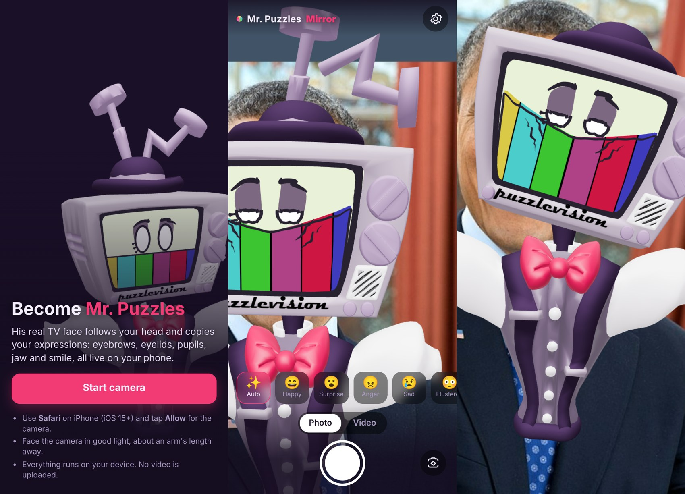
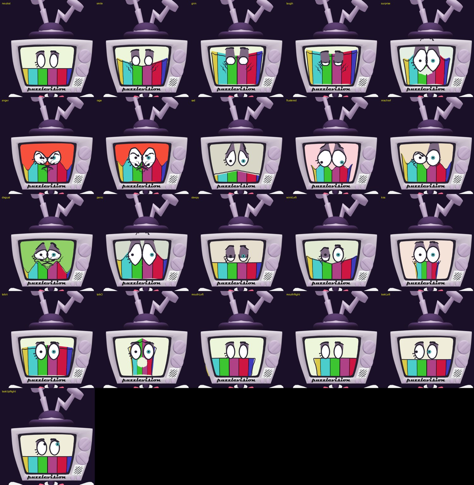

# Mr. Puzzles Mirror - browser AR filter

Open a web page on your iPhone, tap **Start camera**, and **you are Mr. Puzzles**: his TV head follows your head, hides your face,
and his *original face rig* copies your expressions live.

* **Three.js** renders the model, **MediaPipe Face Landmarker** tracks your face (52 blendshapes + head pose matrix), all on-device.
* **Same model, same rig, same expression mapping as the Snapchat Lens project** (kept separately in the `Claude-Code-Storage` repo, folder `mr-puzzles-lens`, untouched). His face is not
  redrawn: the original face meshes are skinned to the original face bones (69 of them), and every expression moves those bones by the
  amounts recorded from the original Blender rig.
* Static site, no build step, no CDN: everything (Three.js, MediaPipe wasm + model, the GLB) is vendored in this folder, so it works
  on **GitHub Pages** over HTTPS and is cached for offline use after the first visit.




*Top: start screen, live camera UI (tracking the test face), rolled head. Bottom: 19 tracked-expression presets through the exact
same pipeline (`MoodLogic` -> rig bones), rendered by this site in headless Chromium.*

## Features

| | |
|---|---|
| Face + head tracking | MediaPipe Face Landmarker (GPU delegate, automatic CPU fallback), One-Euro filtered pose, interpolated to display rate |
| Real rig | independent eyebrows (6 motions/side), eyelids/blink/squint/wide, pupils (4-way gaze/eye), jaw, mouth corners (smile/frown per side), pucker/funnel/shift/jagged teeth, eye wrinkles, dot-eyes -> full-eyes, glass colour per mood |
| Theatrical but smooth | exaggeration (slider 0.8-2.0), per-control attack/release smoothing, moods (happy, surprise, anger, sad, flustered, mischief, disgust), hat pop, antenna springs, squash & stretch, anger shake |
| Hides your face | the opaque TV head (hat, antennas, dials, bow tie, shoulders) is drawn over the video; shoulders follow 30% of head rotation |
| Camera | front/back (flip), selfie-mirror handled correctly (pose, video and left/right eyes), cover-fit video with MediaPipe-matched FOV |
| Capture | **Photo** (JPEG) and **Video** (MP4/H.264 where supported, else WebM, up to 60 s, optional microphone), review sheet with Share / Download |
| Mobile polish | safe-area insets, dynamic viewport, adaptive render resolution + frame-rate governor, adaptive detection spacing, PWA manifest + icons + offline cache |
| Controls | mood chips (force a mood), settings: expressiveness, TV size/height/depth, mirror, shoulders, physics, quality, **calibrate neutral face**, debug overlay |

## PuzzleVision Cam: full-body VTuber app (`/vtuber/`)

A separate app in `vtuber/`. It drives the full **Mr. Puzzles VRM avatar**: face, upper body or
full body, with the ZAMination-style eyes, brows, rainbow mouth and screen effects. It's live at
`https://h4sw5q2wr9-byte.github.io/mr-puzzles-web/vtuber/`.

* **Tracking styles:** ZAMination (default), Balanced and Accurate. There are also sliders for
  expressiveness, eye, brow and mouth exaggeration, and smooth/snappy response. Screen effects (a
  brief red flash on sudden anger, eyelid/brow shading, optional green) can each be toggled. All
  settings are remembered on the device.
* **Mr. Puzzles is built in.** `vtuber/MrPuzzles.vrm` ships with the site and opens
  automatically. It's kept on the phone and only downloaded again when
  `vtuber/MrPuzzles.version.json` changes. A user's own .vrm (⚙︎ → Advanced) takes priority.
* **Credits:** model and rig are BonBon's free fan release "Zamination Style Mr Puzzles Blender 4.0
  Model/Rig" (https://bonbon099.gumroad.com/l/kbmwom), converted to VRM. Mr. Puzzles © SMG4.
  This is an unofficial, non-commercial fan project.
* It loads three.js, three-vrm, Kalidokit and MediaPipe from the jsDelivr CDN, so it needs a
  connection.
* The source of truth is `mr-puzzles-vtuber/app/` and `build/MrPuzzles.vrm` in the private
  `Claude-Code-Storage` repo (tests, converter and report live there). To update, copy them here and
  write the VRM's new hash into `MrPuzzles.version.json`.
* The root app's service worker skips `/vtuber/`, so updates show immediately.

## Run it

```bash
python3 -m http.server 8000          # http://localhost:8000  (desktop browsers allow the camera on localhost)
```

iPhone Safari needs **HTTPS** for the camera, so use GitHub Pages (below), or any HTTPS tunnel to your local server.
The start screen animates the rig through its expressions even before the camera starts. Useful URL flags: `?debug=1` (fps/detect-ms overlay),
`?delegate=cpu` (force the CPU tracker), `?clean=1` (hide UI), `?autostart=1`.

## Publish on GitHub Pages

1. The workflow `.github/workflows/pages.yml` runs on every push to `main` (or start it by hand from the *Actions* tab).
2. Repo **Settings -> Pages -> Build and deployment -> Source: GitHub Actions**.
3. After the workflow finishes, open `https://<your-user>.github.io/<repo>/` on your iPhone in **Safari**, tap *Start camera* and *Allow*.
4. Optional: Share -> *Add to Home Screen* for a full-screen app.

The workflow publishes only the site (not `tools/`, `preview/`, the README). First load downloads about 16 MB raw (MediaPipe wasm 9.5 MB + face model 3.8 MB +
Mr. Puzzles 1.1 MB + Three.js 1.3 MB), roughly 7 MB compressed on GitHub Pages; afterwards it is served from the cache.

## What was verified here, and how

Verified in headless **Chromium (Playwright) emulating an iPhone viewport (390x844, iOS Safari user agent)**, software WebGL, with a **fake camera fed from a real
smiling-face photo** (`node tools/e2e.js <static.y4m> <moving.y4m>`, **31/31 checks pass**; plus `node tools/test_mapping.mjs`):

* Model: 69 face bones found, 13 skinned face meshes, hat + both antennas + bow tie + shoulders + bezel lettering present; 25 draw calls, 34k triangles.
* Rig: all 19 expression presets visibly change the rendered face; the render matches the Blender/Lens previews. A left-eye wink closes the
  **screen-left** eye in mirror view (and the other eye on the back camera); brows and mouth corners move independently; surprise switches to full eyes + pupils; mood chips force a mood (anger = red glass + jagged teeth).
* Tracking: MediaPipe loads (GPU delegate **and** CPU fallback), finds the face, head pose is plausible (~41 cm), blendshapes reach the rig
  (the smiling photo reads smile 0.94/0.92 -> "happy"); the TV follows a **panning and rolling** head (12 cm / 28 degrees range).
* MediaPipe->mood mapping: all 40 expressions the mood logic reads are provided; a broad smile is not mis-read as anger/disgust (MediaPipe quirk, handled).
* Capture: photo = 590x1280 JPEG of the composited canvas; video = valid H.264 MP4 (ffprobe) containing the rendered frames; recording indicator; review sheet.
* UX paths: flip camera, camera missing/denied message with retry, settings persist across reloads, no console/page errors.
* JS cost of mood logic + rig update: ~0.06 ms per frame (desktop CPU).

## Needs a real iPhone (not verifiable in this sandbox) - please test

1. **Safari camera permission + HTTPS flow**, front-camera orientation and mirroring on an actual iPhone, portrait/landscape rotation.
2. **Speed**: MediaPipe's GPU delegate on iOS Safari (WebGL2) and the real fps. Here the GPU delegate runs on software GL (seconds per frame), so no
   timing is meaningful; the app self-adjusts (render resolution governor, detection spacing, CPU fallback) but its tuning is untested on device.
   Use `?debug=1` to read fps and detect-ms.
3. **Head pose accuracy and TV placement**: tuned on one frontal photo. Real yaw/pitch, the exact TV fit (defaults: size 0.72, height -0.5, depth 7 cm) and
   the sign of rotations are unverified on a live moving head. Fix fit with Settings -> TV size/height/depth; if anything is mirrored, toggle *Mirror selfie view*.
4. **Expression feel**: thresholds were calibrated from the MediaPipe values of one smiling face. Use *Calibrate neutral face* and the *Expressiveness* slider; report anything that
   reads wrong (e.g. squints, pouts, one-sided smiles).
5. **Recording on Safari**: `canvas.captureStream` + `MediaRecorder` (MP4 on iOS 14.5+), microphone option, and the Share sheet ("Save Video / Save Image").
6. Battery/thermals over a few minutes; Home-Screen (PWA) mode camera access; service-worker offline use.

Expected requirements (not yet confirmed on device): iOS/iPadOS 15+ Safari with WebGL2 and `MediaRecorder`; recent Chrome on Android should also work.

## How it works (short)

```
camera -> VideoTexture (background, cover-fit, mirrored for the front camera)
       -> MediaPipe FaceLandmarker.detectForVideo  -> blendshapes + 4x4 head pose (cm, 63 deg vertical FOV camera)
            |-> PoseFilter (One-Euro; mirror = F*M*F) -> anchor (position/rotation/scale of the TV head)
            '-> mp_map.js (52 ARKit names -> MoodLogic names, neutral baseline, smile-artifact conditioning)
                -> mood.js (same MoodLogic as the Lens: 51 expressions -> 49 rig controls, mood, style switches, tint)
                -> rig.js  (smooth each control; move the real face bones by the baked per-control offsets in data/rig.json;
                            toggle pupils / wrinkles; glass tint; hat + antenna springs)
       -> WebGLRenderer -> canvas  (photos and video are captured straight from this canvas)
```

* `models/MrPuzzles_Head.glb`, `data/rig.json`, `js/mood.js`, `js/demo_presets.js` are **generated from the Lens project** by `node tools/sync_from_lens.js`
  (read-only; the Lens project is never modified). Re-run it after changing the Lens model/mapping.
* Face layers are unlit (like the original emission shaders); the TV shell, hat, antennas and body are lit PBR with a small procedural environment map.
* The glTF export lost the "puzzlevision" lettering mix; it is restored as a decal (`models/label.png`) positioned by ray-casting the shell.

## Layout

```
index.html  css/style.css  manifest.webmanifest  sw.js  icons/
js/app.js        render loop, UI, capture, camera/pose wiring, quality governor
js/rig.js        the Mr. Puzzles rig driver          js/tracker.js  MediaPipe wrapper (GPU -> CPU fallback)
js/pose.js       One-Euro pose filter, mirroring      js/camera.js   getUserMedia / flip
js/mp_map.js     MediaPipe -> MoodLogic names         js/recorder.js photo + video
js/mood.js, js/demo_presets.js   generated from the Lens project
vendor/          three.js r170, MediaPipe tasks-vision 0.10.18 (wasm, Apache-2.0), loaders
models/          MrPuzzles_Head.glb, face_landmarker.task, label.png      data/rig.json
tools/           e2e.js (browser tests), test_mapping.mjs, sync_from_lens.js
```

Credits: three.js (MIT), MediaPipe (Apache-2.0). Mr. Puzzles is a character you must have the rights to use before publishing the site publicly.
